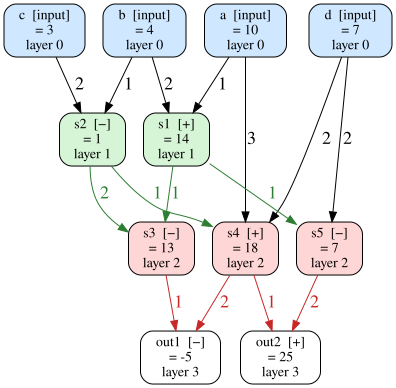

# rusty_graph

[](https://mybinder.org/v2/gh/LosCommodore/RustyGraph/HEAD?labpath=petgraph_dag.ipynb)

A small playground for exploring the [petgraph](https://docs.rs/petgraph) crate in Rust.

It builds a tiny computation graph, a **directed acyclic graph (DAG)** in which each node is a constant input, a sum (`+`) or a difference (`−`), and then:

1. checks that the graph really is acyclic (`is_cyclic_directed`, `toposort`),
2. shows what happens when a cycle is added, and finds it with `tarjan_scc`,
3. sorts the nodes into layers (longest-path layering),
4. computes every node's value in topological order,
5. draws the graph with Graphviz, coloured by layer and labelled with the results.



## Two versions

| | File | Run with |
|---|---|---|
| Plain Rust program | [`src/main.rs`](src/main.rs) | `cargo run` |
| Jupyter notebook | [`petgraph_dag.ipynb`](petgraph_dag.ipynb) | Jupyter with the evcxr Rust kernel |

Both use the same graph. The notebook walks through it one step at a time with explanations, and adds the cycle example and a "play with it" cell.

## Requirements

- Rust (edition 2024)
- [Graphviz](https://graphviz.org/) (`dot`) to render the pictures
- For the notebook only: Jupyter and [evcxr_jupyter](https://github.com/evcxr/evcxr/blob/main/evcxr_jupyter/README.md)

```sh
cargo install evcxr_jupyter
evcxr_jupyter --install
```

## Running

**Program:**

```sh
cargo run
```

This prints the topological order, the layers and the results, and writes `graph.dot` and `graph.svg`.

**Notebook:**

```sh
jupyter notebook petgraph_dag.ipynb
```

You can also open it in VS Code and choose the **Rust** kernel. The first cell compiles petgraph, which takes a few seconds.

## Publishing

GitHub shows the notebook directly, with its saved outputs. [`.github/workflows/pages.yml`](.github/workflows/pages.yml) also publishes it as a web page on GitHub Pages on every push to `main` or `master`. To turn this on, go to the repository's **Settings → Pages** and set **Source** to **GitHub Actions**.

The workflow only converts the notebook to HTML. It does not re-run the notebook, so after changing a cell, run all cells and save before committing.

**Run it online:** the Binder badge at the top opens the notebook in a live Jupyter session, with nothing to install. The first launch after a new commit takes a few minutes while Binder builds the image. Everything Binder needs is in [`.binder/`](.binder/); see [docs/binder.md](docs/binder.md) for how Binder works.

To preview the page locally:

```sh
jupyter nbconvert --to html petgraph_dag.ipynb --output-dir site --output index
```
